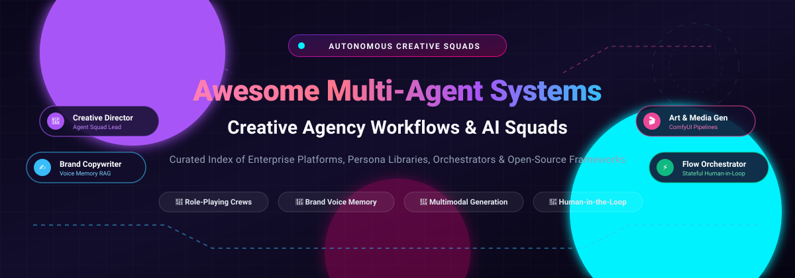

<div align="center">



# 🤖 Awesome Multi-Agent Systems & Creative Agency Workflows 🎨

### 🚀 Curated Directory of Autonomous Creative Agency Squads, Multi-Agent Orchestration Frameworks & AI Marketing Production Workflows

<a href="https://github.com/ishandutta2007/Awesome-Awesome-Awesome"></a><a href="https://discord.gg/jc4xtF58Ve"></a>
[](https://awesome.re)
[](https://creativecommons.org/publicdomain/zero/1.0/)
[](https://github.com/ishandutta2007/Awesome-Multi-Agent-Systems-Creative-Agency-Workflows/pulls)
[](https://github.com/ishandutta2007/Awesome-Multi-Agent-Systems-Creative-Agency-Workflows/pulse)
[](https://github.com/ishandutta2007/Awesome-Multi-Agent-Systems-Creative-Agency-Workflows/stargazers)
<a href="https://github.com/ishandutta2007"></a>

<p align="center">
  <b>Explore state-of-the-art Multi-Agent Systems (MAS) and autonomous creative agency orchestration. Coordinate specialized agent personas (Creative Director, Copywriter, Brand Strategist, SEO Analyst, Social Media Manager, and Art Director) to plan campaigns, enforce persistent brand voice, generate multimodal brand assets, and automate end-to-end client deliverables.</b>
</p>

---

[🌐 Sector Overview](#-sector-overview--market-dynamics) • [💼 SaaS & Enterprise Platforms](#-saashosted-platforms) • [💻 Open-Source Frameworks](#-open-source-github-projects) • [🛠️ Agency Architectures](#-frameworks-for-building-custom-agency-systems) • [⭐ Star History](#-star-history) • [🤝 Contributing](#-how-to-contribute) • [⚖️ Disclaimer](#-disclaimer)

---

</div>

## 📈 Sector Overview & Market Dynamics

The global market for AI Agent and Multi-Agent Systems in enterprise marketing and creative agency workflows is projected to expand from **$5.2B in 2024 to over $35.4B by 2030**, advancing at a compound annual growth rate (**CAGR**) of **37.8%**, driven by the mass transition from single-prompt copilots to autonomous, multi-persona collaboration squads.

The sector is currently **moderately fragmented**: horizontal LLM cloud orchestrators (*LangChain/LangGraph, Dify, Botpress*) and enterprise incumbents (*Jasper, Copy.ai*) dominate foundational infrastructure, while agile open-source multi-agent frameworks (*CrewAI, AutoGen, Agency Swarm, MetaGPT*) and specialized visual pipelines (*ComfyUI, n8n*) capture high-velocity agency adoption, preventing any single winner-take-all monopoly.

---

## 💼 SaaS/Hosted Platforms

A ranked index of leading commercial multi-agent platforms, visual LLM orchestrators, and agency content automation suites. Ranked in **descending order by company scale (market valuation / venture funding / parent revenue)**:

| 🏢 Platform | 💰 Scale (Valuation / Funding) | 🏷️ Starting Paid Tier | 🎁 Free Tier / Free Trial Limit | 🌟 Core Agency Capabilities & Highlights |
| :--- | :--- | :--- | :--- | :--- |
| **[LangGraph Platform (LangChain)](https://langchain.com)** | **$3.0 Billion** valuation *(Series C led by CapitalG)* | **$39.00** /seat/month *(LangSmith Plus)* | **Free Forever**: Developer plan with 1 user seat & 5,000 base traces/month | Enterprise control plane for cyclic, stateful multi-agent workflows with human-in-the-loop review and prompt regression testing. |
| **[Jasper AI](https://jasper.ai)** | **$1.5 Billion** valuation *(~$90M ARR)* | **$59.00** /seat/month *(Pro plan, billed annually)* | **7-Day Free Trial**: Full access to Pro plan features, brand voice studio, and campaign apps | Enterprise creative marketing platform enforcing brand style guides, multi-channel asset generation, and marketing agent workflows. |
| **[Dify Cloud](https://dify.ai)** | **$180 Million** valuation *(LangGenius, $41.5M funding)* | **$59.00** /month *(Professional tier)* | **Free Forever**: Sandbox plan with 5 apps, 50 knowledge docs, 200 message credits, 1 workspace | Cloud LLMOps & drag-and-drop workflow studio for building agency RAG knowledge bases, multi-agent pipelines, and client web tools. |
| **[Botpress](https://botpress.com)** | **$120 Million** valuation *($45M funding, ~$10M+ ARR)* | **$89.00** /month *(Plus plan pay-as-you-go)* | **Free Forever**: 5 active bots, 2,000 incoming messages/month, and community studio access | Conversational multi-agent platform for deploying brand-trained omnichannel client assistants across Web, WhatsApp, and Slack. |
| **[Copy.ai (Fullcast)](https://copy.ai)** | **~$100 Million** valuation *(~$30M ARR)* | **$29.00** /month *(Chat tier; Workflow plans from $249/mo)* | **Free Trial / Credit Allotment**: 200 one-time workflow execution credits on sign-up | Enterprise GTM automation platform orchestrating autonomous outbound prospecting, automated SEO briefs, and multi-model creative copy. |
| **[Stack AI (Asana)](https://stack-ai.com)** | **$75 Million** *(Acquired by Asana; $20M funding)* | **$199.00** /month *(Team tier; custom Enterprise)* | **Free Forever**: 500 workflow runs/month, 2 active projects, 1 seat, and community support | No-code enterprise workflow builder connecting multi-agent research pipelines directly to Snowflake, Notion, Slack, and Google Drive. |
| **[Letta Cloud (formerly MemGPT)](https://letta.com)** | **$70 Million** valuation *($10M seed from Felicis)* | **$19.00** /month *(Starter cloud platform)* | **Free Forever**: BYOK plan with up to 3 active stateful memory agents and hosted ADE | Managed cloud infrastructure for stateful AI agents with self-editing persistent memory retaining client briefs across quarters. |
| **[Relevance AI](https://relevanceai.com)** | **~$50–70 Million** *(~$37M funding led by Bessemer)* | **$19.00** /month *(Pro plan with 2,500 credits)* | **Free Forever**: 100 free monthly execution credits and 1 agent seat for evaluation | No-code B2B multi-agent workforce builder allowing creative agencies to deploy autonomous BDR, research, and copy squads. |
| **[CrewAI Enterprise (AMP)](https://crewai.com)** | **~$40–60 Million** *($18M Series A led by Insight)* | **$25.00** /month *(Cloud Starter; Enterprise custom)* | **Free Forever**: Basic tier with 50 workflow executions/month, visual editor, and copilot | Managed enterprise orchestrator for deploying, monitoring, and debugging role-based multi-agent teams with visual telemetry. |
| **[Flowise Cloud](https://flowiseai.com)** | **~$10–20 Million** *(Seed backed)* | **$35.00** /month *(Starter cloud tier)* | **Free Forever**: 2 active flows, 100 predictions/month, 5 MB vector storage | Hosted visual canvas for assembling LangChain-powered multi-agent architectures, web scrapers, and client chatbots. |
| **[Fixie.ai](https://fixie.ai)** | **~$15–25 Million** *($17M seed led by Redpoint)* | **$0.05** /min usage *(Pro tier $100/mo)* | **Free Forever**: 30 free minutes of real-time speech/voice calls, 5 concurrent sessions | Ultra-low latency voice agent runtime (Ultravox) enabling interactive conversational agency pitch bots and client avatars. |

---

## 💻 Open-Source GitHub Projects

A curated catalog of premier open-source multi-agent frameworks, agency persona repositories, visual workflow builders, and generative multimodal engines. Ranked in **descending order by GitHub stargazers**:

| 📦 Repository | 🌟 GitHub_Stars | 🏷️ Primary Domain / Tech Stack | 📖 Description & Agency Workflow Focus |
| :--- | :--- | :--- | :--- |
| **[n8n](https://github.com/n8n-io/n8n)** | [](https://github.com/n8n-io/n8n/stargazers) | `TypeScript` • Workflow Automation | Fair-code visual automation platform with native AI agent nodes integrating LLMs with 400+ agency tools (WordPress, Notion, Slack, HubSpot). |
| **[Firecrawl](https://github.com/firecrawl/firecrawl)** | [](https://github.com/firecrawl/firecrawl/stargazers) | `TypeScript` • Web Scraping / Extraction | Open-source engine converting entire websites into clean, LLM-ready Markdown for agency competitor research, SEO audits, and content scraping. |
| **[Agency Agents](https://github.com/msitarzewski/agency-agents)** | [](https://github.com/msitarzewski/agency-agents/stargazers) | `Prompts` • Persona Engineering | Comprehensive collection of specialized agency agent personas (Creative Director, Copywriter, Strategist, SEO Specialist, Social Manager). |
| **[Dify](https://github.com/langgenius/dify)** | [](https://github.com/langgenius/dify/stargazers) | `Python` / `TypeScript` • LLMOps & Workflows | Self-hosted visual workflow orchestrator enabling agencies to ground multi-agent pipelines in client brand books, vector databases, and tools. |
| **[Langflow](https://github.com/langflow-ai/langflow)** | [](https://github.com/langflow-ai/langflow/stargazers) | `Python` / `React` • Visual Agent IDE | Drag-and-drop visual Python IDE for rapid prototyping, debugging, and deploying multi-agent creative pipelines and custom RAG chains as APIs. |
| **[LangChain](https://github.com/langchain-ai/langchain)** | [](https://github.com/langchain-ai/langchain/stargazers) | `Python` / `TypeScript` • Agent Framework | The foundational ecosystem for building contextual LLM applications, retrieval-augmented generation pipelines, and composable agent components. |
| **[ComfyUI](https://github.com/Comfy-Org/ComfyUI)** | [](https://github.com/Comfy-Org/ComfyUI/stargazers) | `Python` • Generative Visual Pipeline | Premier modular graph-based execution engine for SDXL, Flux, and video diffusion models, powering automated agency ad-creative generation. |
| **[Browser-Use](https://github.com/browser-use/browser-use)** | [](https://github.com/browser-use/browser-use/stargazers) | `Python` • Autonomous Web Agents | Open-source framework enabling autonomous AI agents to interact with web browsers, perform live competitor ad audits, and handle CMS publishing. |
| **[OpenHands](https://github.com/All-Hands-AI/OpenHands)** | [](https://github.com/All-Hands-AI/OpenHands/stargazers) | `Python` • Autonomous Software Agents | Autonomous AI software development platform capable of modifying codebases, executing terminal commands, and building custom client landing pages. |
| **[MetaGPT](https://github.com/FoundationAgents/MetaGPT)** | [](https://github.com/FoundationAgents/MetaGPT/stargazers) | `Python` • Multi-Agent SOP Framework | Multi-agent collaboration framework encoding Standard Operating Procedures (SOPs) across Product Managers, Architects, Project Managers, and Engineers. |
| **[AnythingLLM](https://github.com/Mintplex-Labs/anything-llm)** | [](https://github.com/Mintplex-Labs/anything-llm/stargazers) | `JavaScript` • Multi-Tenant Knowledge RAG | All-in-one desktop & self-hosted AI client offering isolated client workspaces, custom document embedding, and multi-user agency permissions. |
| **[Microsoft AutoGen](https://github.com/microsoft/autogen)** | [](https://github.com/microsoft/autogen/stargazers) | `Python` • Multi-Agent Conversation | Foundational multi-agent conversational framework from Microsoft Research supporting multi-agent debate, code execution, and AutoGen Studio. |
| **[CrewAI](https://github.com/crewAIInc/crewAI)** | [](https://github.com/crewAIInc/crewAI/stargazers) | `Python` • Role-Playing Agent Teams | Top framework for orchestrating collaborative AI agency teams (Researcher → Strategist → Copywriter → Reviewer) with sequential/hierarchical flows. |
| **[Flowise](https://github.com/FlowiseAI/Flowise)** | [](https://github.com/FlowiseAI/Flowise/stargazers) | `TypeScript` • Drag & Drop LLM Builder | Open-source low-code UI for assembling complex multi-agent architectures, memory stores, and custom tools with one-click API endpoints. |
| **[LangGraph](https://github.com/langchain-ai/langgraph)** | [](https://github.com/langchain-ai/langgraph/stargazers) | `Python` / `TypeScript` • Stateful Cyclic Graph | Stateful orchestration library designed for cyclic multi-agent loops, collaborative revision, editorial quality gates, and human approval checkpoints. |
| **[Fabric](https://github.com/danielmiessler/Fabric)** | [](https://github.com/danielmiessler/Fabric/stargazers) | `Go` / `Markdown` • Prompt & Strategy Patterns | Open-source modular prompt pattern framework for extracting viral hooks, summarizing market research, drafting creative briefs, and writing copy. |
| **[Postiz](https://github.com/gitroomhq/postiz-app)** | [](https://github.com/gitroomhq/postiz-app/stargazers) | `TypeScript` • Social Media Scheduling | Modern open-source social media scheduling and AI-assisted content distribution platform designed for managing multi-client publishing calendars. |
| **[Khoj](https://github.com/khoj-ai/khoj)** | [](https://github.com/khoj-ai/khoj/stargazers) | `Python` • Second Brain & Personal AI | Open-source personal AI assistant and enterprise search engine indexing agency internal Notion, Obsidian, PDF, and Markdown documentation. |
| **[GPT-Researcher](https://github.com/assafelovic/gpt-researcher)** | [](https://github.com/assafelovic/gpt-researcher/stargazers) | `Python` • Autonomous Deep Research | Autonomous research agent crawling 20+ web sources concurrently to generate detailed market intelligence reports, citation briefs, and trend decks. |
| **[Activepieces](https://github.com/activepieces/activepieces)** | [](https://github.com/activepieces/activepieces/stargazers) | `TypeScript` • Open Zapier Alternative | No-code workflow automation engine with native AI pieces connecting agency multi-agent outputs directly into client CRMs and social accounts. |
| **[Letta](https://github.com/letta-ai/letta)** | [](https://github.com/letta-ai/letta/stargazers) | `Python` • Stateful Agent Memory | Stateful LLM architecture (formerly MemGPT) giving agency personas persistent long-term memory to retain client tone and previous project context. |
| **[Listmonk](https://github.com/knadh/listmonk)** | [](https://github.com/knadh/listmonk/stargazers) | `Go` • High-Performance Newsletter | High-performance, self-hosted newsletter and mailing campaign engine ideal for automated distribution of AI-curated agency digest emails. |
| **[CAMEL](https://github.com/camel-ai/camel)** | [](https://github.com/camel-ai/camel/stargazers) | `Python` • Communicative Multi-Agent | Communicative agent framework for simulating consumer focus groups, synthetic buyer interviews, and communicative role-play brainstorming. |
| **[SuperAGI](https://github.com/TransformerOptimus/SuperAGI)** | [](https://github.com/TransformerOptimus/SuperAGI/stargazers) | `Python` • Autonomous Agent Infra | Infrastructure for running autonomous agents concurrently with action loops, performance analytics, and integrated multi-modal tools. |
| **[E2B](https://github.com/e2b-dev/E2B)** | [](https://github.com/e2b-dev/E2B/stargazers) | `Python` / `TypeScript` • Agent Sandbox | Secure cloud sandboxes for AI agents to safely execute code, render graphics, analyze datasets, and process client spreadsheets. |
| **[Mautic](https://github.com/mautic/mautic)** | [](https://github.com/mautic/mautic/stargazers) | `PHP` • Marketing Automation Suite | World-leading open-source marketing automation platform providing lead scoring, campaign nurturing, and multi-channel drip execution. |
| **[AG2](https://github.com/ag2ai/ag2)** | [](https://github.com/ag2ai/ag2/stargazers) | `Python` • Next-Gen AutoGen Community | Community-driven evolution of AutoGen featuring optimized multi-agent messaging patterns, tool integration, and studio interfaces. |
| **[Agency Swarm](https://github.com/VRSEN/agency-swarm)** | [](https://github.com/VRSEN/agency-swarm/stargazers) | `Python` • Org-Chart Multi-Agent Orchestration | Multi-agent framework built explicitly around agency organizational hierarchies with defined inter-agent communication protocols. |

---

## 🛠️ Frameworks for Building Custom Agency Systems

Combine these open-source building blocks into a production-ready, self-hosted autonomous creative studio:

```
                  ┌──────────────────────────────────────────────┐
                  │          Agency Squad Coordinator            │
                  │   (msitarzewski/agency-agents + CrewAI)      │
                  └──────────────────────┬───────────────────────┘
                                         │
        ┌────────────────────────────────┼────────────────────────────────┐
        ▼                                ▼                                ▼
┌──────────────┐                 ┌──────────────┐                 ┌──────────────┐
│ Brand Memory │                 │ Multimodal   │                 │ Deep Market  │
│  & Knowledge │                 │ Media Gen    │                 │ Intelligence │
│(Letta / Dify)│                 │  (ComfyUI)   │                 │(GPT-Research)│
└───────┬──────┘                 └──────┬───────┘                 └──────┬───────┘
        │                               │                                │
        └────────────────────────────────┼────────────────────────────────┘
                                         │
                                         ▼
                  ┌──────────────────────────────────────────────┐
                  │      Stateful Graph & Human Review Gate      │
                  │             (LangGraph / Langflow)           │
                  └──────────────────────┬───────────────────────┘
                                         │
                                         ▼
                  ┌──────────────────────────────────────────────┐
                  │    Publishing, Scheduling & CRM Automation   │
                  │          (Postiz / n8n / Activepieces)       │
                  └──────────────────────────────────────────────┘
```

- **👥 Squad Personas**: Deploy curated roles with `msitarzewski/agency-agents` or `danielmiessler/Fabric`.
- **⚙️ Orchestration Engine**: Coordinate role delegation using `crewAIInc/crewAI`, `VRSEN/agency-swarm`, or `microsoft/autogen`.
- **🧠 Persistent Memory**: Retain client tone and historical feedback across campaigns via `letta-ai/letta`.
- **🎨 Visual Asset Generation**: Automate brand-aligned image and video generation pipelines via `comfyanonymous/ComfyUI`.
- **🔎 Competitor Intelligence**: Crawl target landing pages and ad copy using `mendableai/firecrawl` and `browser-use/browser-use`.
- **🔄 Human-in-the-Loop Sign-off**: Implement approval gates and editorial reviews with `langchain-ai/langgraph`.
- **🚀 Multi-Channel Distribution**: Publish verified copy directly to social feeds, CMS, and email with `gitroomhq/postiz-app` and `n8n-io/n8n`.

---

## 🤝 How to Contribute

We welcome additions of emerging multi-agent frameworks, persona packs, and agency workflow tools!

1. 🍴 **Fork** the repository.
2. 📝 **Add or update** entries in `README.md` following the table format.
3. 🔗 Include verified links, transparent pricing/free-tier data, and accurate GitHub Stars_Badges.
4. 🚀 **Submit a Pull Request** with a descriptive summary of your changes.

---

## 💖 Support & Community

If you find this directory helpful for your creative agency, startup, or AI research:
- ⭐ **Star this repository** to help others discover it!
- 🍴 **Fork it** and contribute your favorite open-source tools and agent workflows.
- 📢 **Share it** with your network on LinkedIn, X/Twitter, and Discord.
- ☕ **Sponsor the Project**: Support ongoing curation and maintenance via GitHub Sponsors:  
  [](https://github.com/sponsors/ishandutta2007)

---

##  Star History
#[](https://star-history.dera.page/#ishandutta2007/Awesome-Multi-Agent-Systems-Creative-Agency-Workflows&type=date&legend=top-left)`
[](https://www.star-history.com/#ishandutta2007/Awesome-Multi-Agent-Systems-Creative-Agency-Workflows&type=date&legend=top-left)`

---

## ⚖️ Disclaimer

- This repository is a **community-curated directory** created for educational, research, and technical exploration.
- **Human Oversight**: AI-generated marketing copy, visual assets, and competitor research can contain factual errors, hallucinations, or copyright overlap; always enforce human creative review before publishing client deliverables.
- **Client Data Isolation**: When deploying multi-tenant agent systems for agency clients, enforce strict workspace isolation and vector database segregation to prevent cross-account confidential data leakage.

---

<div align="center">
  <b>Built for creative agencies, growth marketers, content studios, and AI workflow architects.</b><br />
  ⭐ If this directory helped your agency team, don't forget to star the repository!
</div>
